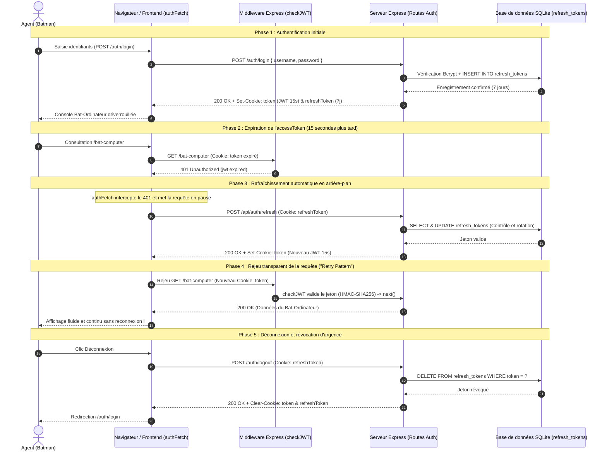

# TP1 - Système de Sécurité de la Batcave

Serveur centralisé d'authentification et de contrôle d'accès au Bat-Ordinateur, missionné par Bruce Wayne et Alfred Pennyworth.

Le système s'appuie sur une authentification HTTP **Basic Auth**, un hachage salé via **Bcrypt** et une persistance sous **SQLite** (`better-sqlite3`).

---

## 1. Contexte et Architecture Fonctionnelle

Le module assure le cloisonnement entre les espaces d'accès public et les ressources confidentielles de la Batcave :

- **Registre des justiciers** : Formulaire d'enregistrement (`/register.html`) avec validation stricte côté serveur (mot de passe $\ge 8$ caractères, suppression des espaces résiduels, gestion des conflits d'unicité avec code `409 Conflict` et hachage `bcrypt`). Les comptes créés sont persistés localement dans le fichier SQLite `database.db` (table `users`), consultable avec l'extension VS Code *SQLite Viewer*.
- **Protection Basic Auth** : Interception systématique des routes sensibles par le middleware `basicAuth`. En cas d'identifiants absents ou invalides, retour d'un statut `401 Unauthorized` avec l'en-tête standard `WWW-Authenticate: Basic realm="Batcave"`.
- **Espace opérationnel & Rapports** : Console du Bat-Ordinateur servie depuis un répertoire privé (`/bat-computer`), restitution nominative du profil (`GET /api/me`), exposition de l'arsenal tactique (`GET /api/secrets`) et persistance des notes de mission (`/api/reports`).
- **Mesures de sécurité avancées** : Contrôle d'accès basé sur les rôles (RBAC) interdisant les endpoints sensibles aux agents non autorisés (`403 : Accès refusé`), journalisation systématique dans la table `logs`, protection anti force brute (blocage temporaire de 30 secondes après 3 échecs) et point de déconnexion `/logout`.

---

## 2. Modèle de Données SQLite (`database.db`)

```sql
-- Table des utilisateurs et rôles
CREATE TABLE users (
    id INTEGER PRIMARY KEY AUTOINCREMENT,
    username TEXT UNIQUE NOT NULL,
    password TEXT NOT NULL,
    role TEXT DEFAULT 'JUSTICIER'
);

-- Table des rapports de mission
CREATE TABLE reports (
    id INTEGER PRIMARY KEY AUTOINCREMENT,
    user_id INTEGER NOT NULL,
    title TEXT NOT NULL,
    content TEXT NOT NULL,
    created_at DATETIME DEFAULT CURRENT_TIMESTAMP,
    FOREIGN KEY (user_id) REFERENCES users(id) ON DELETE CASCADE
);

-- Table des journaux d'audit de sécurité
CREATE TABLE logs (
    id INTEGER PRIMARY KEY AUTOINCREMENT,
    timestamp DATETIME DEFAULT CURRENT_TIMESTAMP,
    ip TEXT NOT NULL,
    username TEXT,
    success INTEGER NOT NULL
);
```

---

## 3. Spécification des Endpoints de l'API

| Méthode | Route | Accès | Description |
| :--- | :--- | :--- | :--- |
| `POST` | `/register` | Public | Enregistrement d'un nouvel agent (`username`, `password`, optionnel `role`) |
| `GET` | `/register.html` | Public | Formulaire web d'enregistrement |
| `GET` | `/bat-computer` | Basic Auth | Console du Bat-Ordinateur (servie depuis `private/`) |
| `GET` | `/api/me` | Basic Auth | Informations de l'agent authentifié (`id`, `username`, `role`) |
| `GET` | `/api/secrets` | Basic Auth | Liste des équipements et gadgets tactiques |
| `POST` | `/api/reports` | Basic Auth | Enregistrement d'un rapport de mission |
| `GET` | `/api/reports` | Basic Auth | Historique des rapports (propres à l'agent ou globaux pour ADMIN) |
| `GET` | `/api/admin/logs` | ADMIN | Consultation des 50 dernières entrées d'audit |
| `GET` | `/logout` | Public | Fermeture de session et purge des identifiants |

---

## 4. TP2 - Le Système de Badges de la Batcave (Modernisation)

Le système Basic Auth transmettait les identifiants à chaque requête HTTP et ne permettait pas de révoquer un appareil spécifique sans changer le mot de passe. Alfred a exigé une modernisation : authentification par badge éphémère (Session ID signé via cookie HTTP-only `bat_identity`).

### 4.1 Architecture Modulaire
Le code monolithique `server.js` a été refactorisé selon une structure modulaire découplée :
- `config/database.js` : Initialisation SQLite, clés étrangères et tables relationnelles.
- `middlewares/authCheck.js` : Vigile `isAuthenticated` vérifiant `req.session.user` (renvoi 401 et redirection `/auth/login`).
- `middlewares/antiHijack.js` : Détection du vol de session par empreinte client IP + User-Agent (Bonus 2).
- `middlewares/checkRole.js` : Contrôle d'accès basé sur les rôles (RBAC).
- `routes/auth.js` : Routeur de session (`GET /auth/login`, `POST /auth/login`, `GET /auth/logout`).
- `routes/batcomputer.js` : Console Batcomputer servie depuis `views/bat-computer.html`.
- `routes/register.js` : Création de compte justicier avec validation stricte et promotion automatique du premier compte en `ADMIN`.
- `routes/reports.js` : Gestion des rapports de mission (personnels ou supervision globale pour l'ADMIN).
- `routes/secrets.js` : Arsenal tactique de Batman et profil de session.
- `routes/admin.js` : Console d'audit des flux de connexion (`GET /admin/audit` et `GET /admin/api/audit-logs`) (Bonus 3).
- `views/` : Interfaces HTML sécurisées servies hors du dossier public (`login.html`, `bat-computer.html`, `audit.html`).

### 4.2 Configuration et Sécurité des Cookies (`.env`)
Les secrets sont externalisés dans un fichier `.env` chargé via `dotenv` :
```env
PORT=3000
SESSION_SECRET=batcave_super_secret_session_key_2026_top_secret_bruce_wayne
```
Le cookie de session `bat_identity` est configuré avec des règles de sécurité strictes :
- **`name: "bat_identity"`** : Dissimule l'empreinte technologique Express/Connect.
- **`httpOnly: true`** : Interdit l'accès au cookie via les scripts JS clients (protection XSS).
- **`sameSite: "strict"`** : Bloque l'envoi du cookie lors de requêtes cross-site (protection CSRF).
- **`maxAge: 1800000`** : Expiration automatique après 30 minutes d'inactivité.

### 4.3 Fonctionnalités Bonus Implémentées
1. **Session Store Persistant SQLite (Bonus 1)** : Utilisation de `better-sqlite3-session-store` connecté sur l'instance SQLite. Les sessions survivent à un redémarrage du serveur Node sans forcer les agents à se reconnecter.
2. **Détection de Vol de Session (Anti-Hijacking - Bonus 2)** : L'IP et le User-Agent enregistrés au login sont vérifiés à chaque requête protégée. En cas de divergence, la session est détruite, le cookie effacé, l'incident consigné en `FRAUD` et la requête bloquée (403 Forbidden).
3. **Registre d'Audit et Console ADMIN (Bonus 3)** : La table `connexions_audit` journalise chaque `LOGIN`, `LOGOUT` et `FRAUD`. Une console dédiée `/admin/audit` offre un tableau de bord visuel filtrable en temps réel aux administrateurs.

### 4.4 Endpoints de l'API (TP2)

| Méthode | Route | Accès | Description |
| :--- | :--- | :--- | :--- |
| `GET` | `/` | Public | Redirection intelligente vers `/bat-computer` ou `/auth/login` |
| `GET` | `/auth/login` | Public | Formulaire HTML d'identification (Tailwind Batcave) |
| `POST` | `/auth/login` | Public | Vérification identifiants, régénération anti-fixation, cookie `bat_identity` |
| `GET` | `/auth/logout` | Session | Destruction de session, purge du cookie et redirection |
| `POST` | `/register` | Public | Enregistrement d'un nouvel agent (Bcrypt, règle premier ADMIN) |
| `GET` | `/bat-computer` | Session | Interface sécurisée du Bat-Ordinateur |
| `GET` | `/api/me` | Session | Informations de l'agent connecté (`id`, `username`, `role`) |
| `GET` | `/api/secrets` | Session | Arsenal tactique de Batman |
| `GET` | `/api/reports` | Session | Consultation des rapports (tous si `ADMIN`, personnels sinon) |
| `POST` | `/api/reports` | Session | Enregistrement d'un rapport de mission |
| `GET` | `/admin/audit` | Session `ADMIN` | Interface web de la console de surveillance des badges |
| `GET` | `/admin/api/audit-logs` | Session `ADMIN` | Flux JSON des événements d'audit avec filtrage |

---

## 5. TP3 - Le Système de Jetons de la Batcave (Architecture Stateless)

Pour résoudre les crises de saturation mémoire et l'inconfort opérationnel de Batman lors des coupures de session en pleine mission, l'architecture évolue vers un modèle **stateless sécurisé** fondé sur le couple de jetons :
1. **`accessToken`** : Jetons JWT éphémères signés cryptographiquement (durée courte de 15 secondes pour les démonstrations de rotation).
2. **`refreshToken`** : Chaîne aléatoire cryptographique opaque valide 7 jours, persistée dans la table SQLite `refresh_tokens`.

### 5.1 Modélisation du Flux et Cycle de Vie (Étape 1)

Le schéma ci-dessous modélise le cycle complet de connexion, d'expiration, de rafraîchissement transparent en arrière-plan et de rejeu automatique ("Retry Pattern") :



> [!NOTE]
> Le schéma technique haute résolution au format image est disponible à la racine du dépôt : [`tp3-architecture-flux.png`](../tp3-architecture-flux.png).

---

> [!NOTE]
> Pour les instructions d'installation, de lancement et les procédures de validation (cURL, Postman, navigateur), consultez le document racine [`DEVELOPMENT.md`](../DEVELOPMENT.md).
